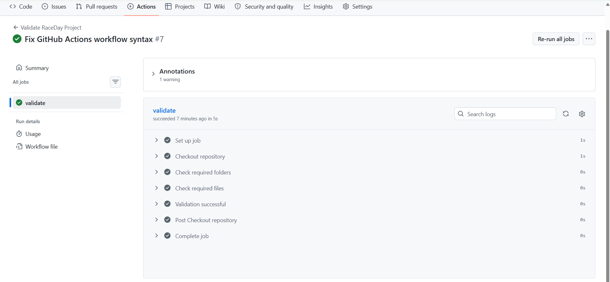
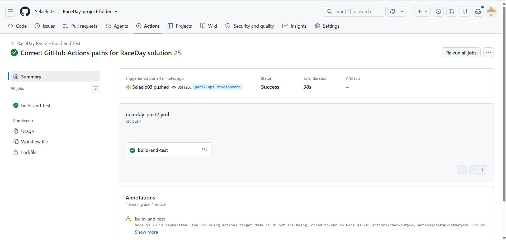

# RaceDay

RaceDay is an event management and race results system designed to allow participants to register for events, select categories, and view their results, while organisers can create and manage events, categories, enrolments and results.

## Project Structure

- `docs/` – ERD, API endpoint plan, SQL Server database script and CI/CD evidence
- `.github/workflows/` – GitHub Actions workflow for project validation
- `README.md` – Project documentation

## Main Features

- User registration and authentication
- Participant and organiser profiles
- Event management
- Event category management
- Participant enrolments
- Race result management
- SQL Server database
- REST API endpoint planning
- Automated GitHub repository validation using GitHub Actions

## User Roles

### Participant

Participants can register for the RaceDay system, manage their profile, view available events, enrol in events by selecting a category, and view their race results.

### Organiser

Organisers can create and manage events and categories, view participant enrolments, and record race results.

## Technologies

- SQL Server
- REST API
- GitHub
- GitHub Actions
- diagrams.net (draw.io)
- Microsoft SQL Server Management Studio (SSMS)

## Documentation

The project documentation is available in the `docs/` folder.

### ERD

The Entity Relationship Diagram defines the database structure, entities, primary keys, foreign keys and relationships used by the RaceDay system.

**File:** `docs/RaceDay_ERD.drawio.png`

### API Endpoint Plan

The API Endpoint Plan documents the REST API routes, HTTP methods, descriptions, required roles, request bodies and expected responses.

**File:** `docs/API_Endpoint_Plan_RaceDay.pdf`

### SQL Database Script

The SQL Server database script creates the RaceDay database, tables, relationships, constraints and sample data.

**File:** `docs/RaceDay_Database.sql`

## Database

The RaceDay system uses Microsoft SQL Server.

The database contains the following main entities:

- User
- Participant
- Organiser
- Event
- Category
- Enrollment
- Result

The database script includes sample data for organisers, participants, events, categories, enrolments and race results.

## CI/CD Validation

The project uses GitHub Actions to automatically validate the required repository structure and documentation files.

A successful GitHub Actions build is shown below:

## YouTube Walkthrough

The RaceDay POE Part 1 walkthrough demonstrates the project documentation, ERD, API Endpoint Plan, SQL database script, database execution, GitHub repository and successful GitHub Actions validation.

[Watch the RaceDay POE Part 1 Walkthrough](https://youtu.be/-ABR4bDZkoE)

## Repository

The complete RaceDay project is available on GitHub:

https://github.com/Selaelo03/RaceDay-project-folder

# RaceDay — Part 2: RESTful API Development

## Project Overview

RaceDay is an event management application developed using ASP.NET Core Web API, .NET 10, Entity Framework Core, and Microsoft SQL Server.

The API allows organisers to manage sporting events, categories, participant enrolments, and results. Participants can register, manage their profiles, enrol in events, and view their results.

## Technologies Used

- C# and ASP.NET Core Web API (.NET 10)
- Microsoft SQL Server
- Entity Framework Core
- JSON Web Tokens (JWT)
- Swagger / OpenAPI
- xUnit
- GitHub Actions

## User Roles

**Participant:** Register, log in, view and update their profile, browse events and categories, enrol in events, and view their results.

**Organiser:** Register, log in, view and update their profile, create and manage their own events and categories, view event enrolments, and record results.

## API Endpoints

| Method | Endpoint | Description |
|---|---|---|
| POST | `/api/auth/register` | Register a user |
| POST | `/api/auth/login` | Authenticate and receive JWT |
| GET | `/api/users/profile` | View own profile |
| PUT | `/api/users/profile` | Update own profile |
| GET | `/api/events` | View events |
| GET | `/api/events/{id}` | View an event |
| POST | `/api/events` | Create an event |
| PUT | `/api/events/{id}` | Update an event |
| DELETE | `/api/events/{id}` | Delete an event |
| GET | `/api/events/{eventId}/categories` | View event categories |
| POST | `/api/events/{eventId}/categories` | Create a category |
| PUT | `/api/events/{eventId}/categories/{categoryId}` | Update a category |
| DELETE | `/api/events/{eventId}/categories/{categoryId}` | Delete a category |
| POST | `/api/events/{eventId}/enrollments` | Enrol in an event |
| GET | `/api/users/profile/enrollments` | View own enrolments |
| GET | `/api/events/{eventId}/enrollments` | View event enrolments |
| POST | `/api/enrollments/{enrollmentId}/result` | Record a result |
| GET | `/api/users/profile/results` | View own results |

## Running the Project

1. Install Visual Studio with ASP.NET and web development support, .NET 10 SDK, and Microsoft SQL Server.
2. Clone the repository and open `RaceDay/RaceDay.slnx`.
3. Restore the NuGet packages.
4. Configure a local SQL Server connection string and JWT signing key in the application's local configuration. Do not commit credentials or signing keys.
5. Apply the Entity Framework Core database migrations, if applicable to the configured project.
6. Set `RaceDay.API` as the startup project and run the application.
7. Open Swagger at the application's `/swagger` endpoint.

## Authentication and Authorization

The API uses JWT bearer authentication. Passwords are stored as hashes rather than plaintext. Protected endpoints require authentication, and organiser-only operations use role-based authorization.

## Unit Testing

The `RaceDay.API.Tests` project contains five xUnit model tests covering event properties and updates, category age limits, enrolment references, and result finishing positions.

The existing tests can be executed using:

`dotnet test RaceDay/RaceDay.API.Tests/RaceDay.API.Tests.csproj`

## GitHub Actions — Continuous Integration

The workflow is defined in `.github/workflows/raceday-part2.yml`.

It automatically restores dependencies, builds the .NET 10 solution, and runs the unit tests on configured pushes and pull requests.

**Successful GitHub Actions Workflow:**

## Demonstration Video

**YouTube video:** Link to be added after recording and uploading the Part 2 demonstration.

## Repository Structure

- `database/` — Database scripts
- `docs/` — Part 1 documentation and supporting evidence
- `RaceDay/RaceDay.API/` — ASP.NET Core Web API
- `RaceDay/RaceDay.API.Tests/` — Unit test project
- `.github/workflows/` — GitHub Actions workflows

## Development Branch

Part 2 development is available on the `part2-api-development` branch.
